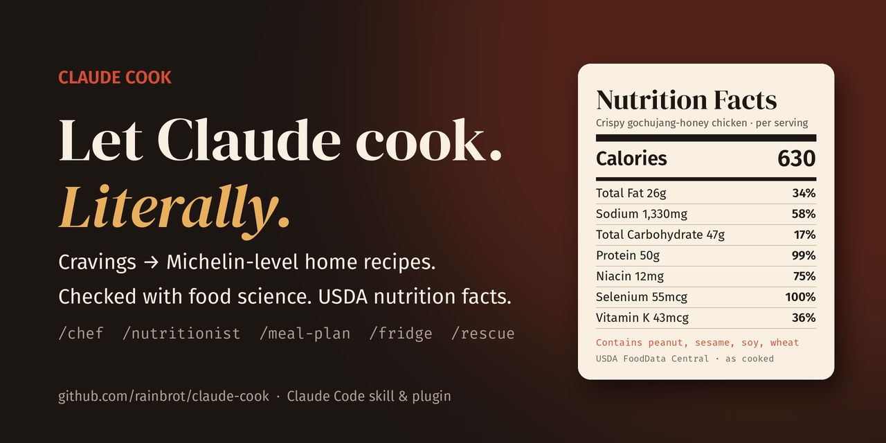
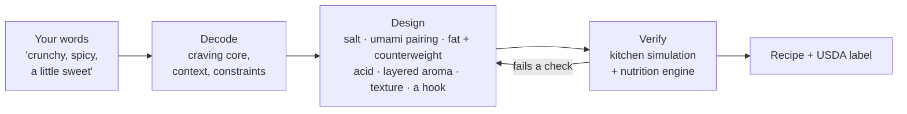

<p align="center">
  
</p>

<p align="center">
  <a href="https://github.com/rainbrot/claude-cook/stargazers"></a>
  <a href="https://github.com/rainbrot/claude-cook/actions/workflows/test.yml"></a>
  <a href="LICENSE"></a>
  
  
  
</p>

<h1 align="center">Claude Cook</h1>

<p align="center"><b>Let Claude cook. Literally.</b><br>
A <a href="https://docs.claude.com/en/docs/claude-code">Claude Code</a> skill that reads what you're actually craving, designs a recipe like a Michelin-trained chef working in <i>your</i> kitchen, checks it against food science, and finishes with a real USDA nutrition label.</p>

```
/plugin marketplace add rainbrot/claude-cook
/plugin install cook@rainbrot
```

Then just talk about food. Or use the shortcuts:

```
/chef something crunchy, spicy and a little sweet with chicken thighs
/nutritionist 140 g protein a day, vegetarian, I hate meal prep
/meal-plan 5 dinners for 2, $80 budget, one of us is gluten-free
/fridge half a cabbage, eggs, leftover rice, scallions, kimchi
/nutrition-label <paste any recipe>
/rescue my curry is way too salty and guests arrive in 20 minutes
```

## Same prompt, with and without

*"I'm craving something crunchy, spicy and a little sweet for dinner tonight. I've got chicken thighs and not a lot of energy."* Same model, fresh sessions, unedited ([full outputs](examples/with-vs-without.md)).

| | Claude | Claude + Claude Cook |
|---|---|---|
| Quantities | "1–2 tbsp gochujang", "oil for the pan", "salt and pepper" | every ingredient in grams and cups |
| Salt | to taste | 1 g, given as Diamond Crystal, Morton *and* table salt (they differ 2× by volume) |
| Doneness | times | times **plus** cues: "a pinch of cornstarch sizzles right away", "lift off the pan easily" |
| Why it works | — | cornstarch's glassy crust, glaze reduced *before* tossing, a second crunch that survives the sauce |
| Allergens | — | peanut, sesame, soy, wheat, plus the catch that most gochujang contains wheat |
| Nutrition | — | full as-cooked label: calories, macros, 21 vitamins and minerals, %DV |

```
NUTRITION FACTS - Crispy gochujang-honey chicken
2 servings | serving ~269 g (as cooked)
==============================================
Calories                                   630
----------------------------------------------
                                % Daily Value*
Total Fat 26g                              34%
   Saturated Fat 4.5g                      22%
   Trans Fat 0g
Cholesterol 210mg                          70%
Sodium 1,330mg                             58%
Total Carbohydrate 47g                     17%
   Dietary Fiber 2g                         7%
   Total Sugars 21g
      Includes 20g Added Sugars            40%
Protein 50g                                99%
==============================================
Vitamin D 0.00mcg 0%   Calcium 83mg 6%
Iron 3.0mg 17%         Potassium 614mg 13%
----------------------------------------------
Vitamin A 19mcg 2%     Vitamin C 3.4mg 4%
Vitamin E 2.3mg 16%    Vitamin K 43mcg 36%
Thiamin 0.20mg 16%     Riboflavin 0.46mg 36%
Niacin 12mg 75%        Vitamin B6 0.94mg 55%
Folate 30mcg 7%        Vitamin B12 0.89mcg 37%
Choline 95mg 17%       Magnesium 83mg 20%
Phosphorus 416mg 33%   Zinc 4.4mg 40%
Selenium 55mcg 100%    Copper 0.40mg 44%
Manganese 0.48mg 21%
Omega-3 0.80g
----------------------------------------------
* %DV = share of a 2,000-calorie daily diet.
```

More: [a nutritionist-mode dinner built from someone's own calorie and protein targets](examples/nutritionist-weight-loss-dinner.md).

## How it thinks



- **Decode.** "Healthy mac and cheese" still wants creamy, cheesy, salty, soft starch. Claude Cook names that *craving core* and protects it in every swap, so you don't get handed zucchini noodles.
- **Design.** Every dish gets a flavor architecture: seasoning in grams, an umami pairing that multiplies (glutamate + nucleotides, like tomato with parmesan or kombu with bonito), fat with something that cuts it, acid for lift, aroma layered by timing, at least one texture contrast, and one memorable hook.
- **Verify.** Before you see anything, the recipe runs through a kitchen simulation. Are the times real (onions don't caramelize in 10 minutes)? Will the pan brown or steam? Will the sauce break? Is bite ten as good as bite one? Where will a home cook most likely fail? Then the numbers: the engine checks salt as a percentage of the dish against targets for 30+ dish types. In testing, a first draft came back salt-HIGH, and Claude fixed it before replying.
- **Deliver.** Grams first, salt for every brand, °F and °C, and a sensory checkpoint at every step that can go wrong.

**Science-first, never snobby.** Every technique is justified by a mechanism you can reuse elsewhere, and each recipe teaches at least one transferable principle. "Elevated" is a choice Claude makes per dish: by default it makes the best version of what people actually love to eat, and it only goes fancier when that makes your meal better or you ask for it. Jarred sauce, MSG and American cheese are fair game when they're the right tool.

Two personalities on purpose. **Chef** maximizes deliciousness. **Nutritionist** treats your targets as hard constraints and hits them with the flavor levers that cost no calories: salt to target, acid, umami, aroma, browning, heat and texture. It puts the fat and sugar where your tongue meets them first instead of dissolving them into the dish.

## The nutrition engine

No guessing at numbers. `nutrition.py` is a zero-dependency Python engine that follows USDA's own recipe-calculation method:

| Step | Source |
|---|---|
| 6,781 foods × 42 nutrients | USDA FoodData Central, SR Legacy (bundled, works offline) |
| "1 medium onion", "2 cups flour", "1 stick butter" → grams | 12,771 USDA household portion weights + 650 everyday ingredient names |
| Cooking losses (`~boil` broccoli loses vitamin C; `~braise:150` wine keeps 5% of its alcohol) | USDA Table of Nutrient Retention Factors, Release 6: 270 food-group × method profiles |
| Cooked weight and fat you pour off (`~brown+drain`) | derived from USDA raw/cooked food pairs |
| Gochujang, mirin, MSG, nutritional yeast, oat milk… | USDA Branded and Foundation records |
| Any brand you name (`=online`) | live FoodData Central search, including its Branded Foods database |
| Missing lab values | filled from the closest related USDA foods, and flagged on the label |
| Added sugars | FDA definition (sweeteners, not the lactose or fruit sugar an ingredient carries) |
| Rounding, %DV | FDA labeling rules and 2016 Daily Values |

Beyond the label, every analysis reports:
- salt % against the target for the dish type;
- energy density, which predicts how full a meal keeps you;
- Fazzino 2019 hyper-palatability flags (fat + sugar, fat + sodium, carbs + sodium);
- which ingredients supply acid, umami, heat, crunch and so on, so a missing role like "crunch: NONE" is visible;
- whether you have umami synergy;
- the 9 major allergens, plus brand-dependent ones.

It also does personal targets (Mifflin-St Jeor with DRIs by age and sex), meal-plan day totals, and grocery lists:

```bash
python3 skills/cook/scripts/nutrition.py analyze recipe.txt
python3 skills/cook/scripts/nutrition.py targets --sex f --age 34 --height 5\'6\" --weight 150lb --activity moderate --goal lose --out me.json
python3 skills/cook/scripts/nutrition.py day week.txt --targets me.json
python3 skills/cook/scripts/nutrition.py shop week.txt
```

<details>
<summary>Recipe file format</summary>

```
# Chicken tinga tacos
servings: 4
type: braise                          # turns on the salt-target check
900 g boneless skinless chicken thighs ~braise:45
1 large white onion, sliced ~saute
1 (400 g) can crushed tomatoes ~simmer
2 tsp Diamond Crystal kosher salt
juice of 1 lime
8 corn tortillas ~toast
450 g ground beef ~brown+drain         # rendered fat poured off
1000 g canola oil @8%                  # only 8% is eaten (deep frying)
2 tbsp Mother-in-Law's gochujang =online   # this exact product's label
1/2 cup cilantro =fdc:169997           # pin an exact USDA record
20 g chili crisp {kcal=600 fat=55 carb=20 sodium=1100}   # per-100 g values from a jar
```

Methods: `bake roast broil grill saute stirfry panfry sear fry fry-coated boil blanch simmer stew braise steam microwave poach toast brown mash reheat flame deglaze`, with optional `:minutes` and `+drain`.
</details>

## Install

**Claude Code (plugin):**

```
/plugin marketplace add rainbrot/claude-cook
/plugin install cook@rainbrot
```

**Claude Code (skills folder):**

```bash
git clone https://github.com/rainbrot/claude-cook
cp -r claude-cook/skills/* ~/.claude/skills/
```

**Claude.ai and the Claude desktop app:** download [`cook.zip`](https://github.com/rainbrot/claude-cook/releases/latest) from the latest release and upload it under **Settings → Capabilities → Skills** (code execution on). Then just ask in plain language.

**Other agents that support the [Agent Skills](https://agentskills.io) format:** `npx skills add rainbrot/claude-cook`, or copy `skills/cook` into the agent's skills folder.

**Requirements:** Python 3.8+, standard library only. Online lookups are optional and free; set a free [FoodData Central API key](https://fdc.nal.usda.gov/api-key-signup) as `FDC_API_KEY` for heavy use. Without Python, recipes still work and labels are estimated and marked as such.

## FAQ

**Is this an MCP server?** No, and on purpose. It's an Agent Skill with a bundled offline database: no server to run, no API key, no setup. It works anywhere Claude can run Python, including Claude Code, Claude.ai code execution and the API.

**How accurate is the nutrition?** It uses the same inputs and method USDA uses to calculate recipes: lab-analyzed foods, official portion weights, retention factors for cooking losses, and yields. The label shows which ingredients matched which USDA records and flags any filled values. Real food varies (your onion isn't USDA's average onion), so weigh ingredients for the tightest numbers.

**Does it need fancy equipment or ingredients?** No. It assumes a supermarket, a skillet, a pot and a sheet pan. Anything regional comes with a swap ("gochujang, or sriracha + miso"), and anything special comes with an alternative (no grill → broiler).

**How many tokens does it cost?** About 250 tokens of skill description sit in context for every session. The full skill (~4.6k tokens) loads only when you talk about food. The reference library (flavor science, kitchen chemistry, baking, nutrition) loads one section at a time, only when a request needs it.

**Is this medical advice?** No. It's food and nutrition information. Nutritionist mode defers to clinicians for kidney disease, diabetes medication, pregnancy complications and eating disorders, and it won't push numbers on someone who signals disordered eating.

## What's inside

```
skills/
├── cook/                      the skill that does the thinking
│   ├── SKILL.md               decode → design → verify → deliver
│   ├── references/            loaded a section at a time
│   │   ├── flavor.md          palatability science, umami synergy, aroma layering, 20 cuisine grammars
│   │   ├── science.md         heat, browning, proteins, starches, emulsions, frying, enzymes, food safety
│   │   ├── numbers.md         salt targets, ratios, doneness temps, cup weights, yields, pan sizes
│   │   ├── cravings.md        moods, occasions and vague asks → sensory targets
│   │   ├── access.md          equipment and ingredient substitutes, budget, dietary adaptations
│   │   ├── nutrition.md       targets, protein, fiber, micronutrients, bioavailability, goal playbooks
│   │   ├── meal-planning.md   component-based plans, storage, verification
│   │   ├── baking.md          formula chemistry, leavening, doughs, failures
│   │   └── rescue.md          fixes for anything going wrong mid-cook
│   ├── scripts/               nutrition.py + cooking.py (zero dependencies)
│   └── data/                  USDA tables, retention factors, yields, aliases
└── chef, nutritionist, meal-plan, nutrition-label, fridge, rescue/   slash-command shortcuts
evals/       graded test cases for `claude plugin eval`
examples/    unedited outputs from real sessions
tests/       28 nutrition-engine and packaging tests (CI on Python 3.8 and 3.13)
```

## Contributing

Cooked something with it? [Share it in Discussions](https://github.com/rainbrot/claude-cook/discussions). Did the skill get something wrong in your kitchen? [Open a recipe report](https://github.com/rainbrot/claude-cook/issues/new/choose). Those reports are the most valuable contribution there is. Ingredient name fixes, regional cuisines and substitutions are very welcome; see [CONTRIBUTING.md](CONTRIBUTING.md).

If Claude Cook made you dinner, a ⭐ helps other people find it.

## Inspiration

The approach owes a lot to science-first home-cooking educators like Ethan Chlebowski and J. Kenji López-Alt, who explain *why* techniques work and cook for enjoyment rather than prestige. No affiliation or endorsement implied.

## License

MIT. Nutrient data from USDA FoodData Central and the USDA Table of Nutrient Retention Factors is public domain. Claude Cook is an independent community project and isn't affiliated with or endorsed by Anthropic.
